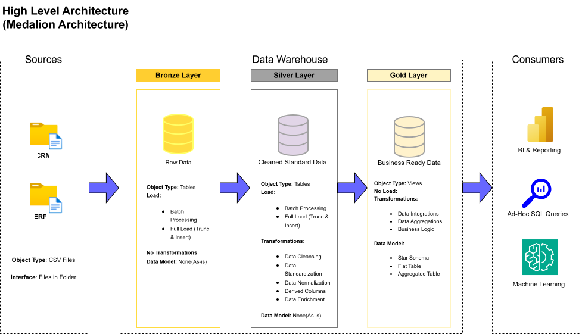
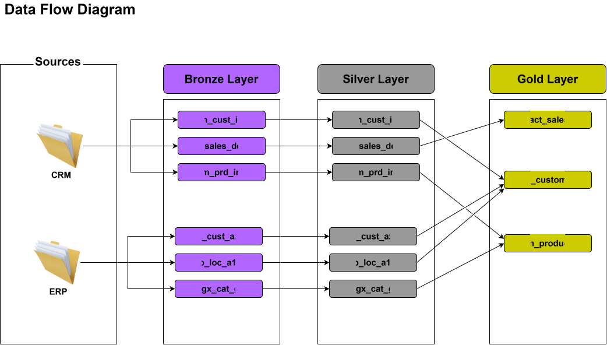
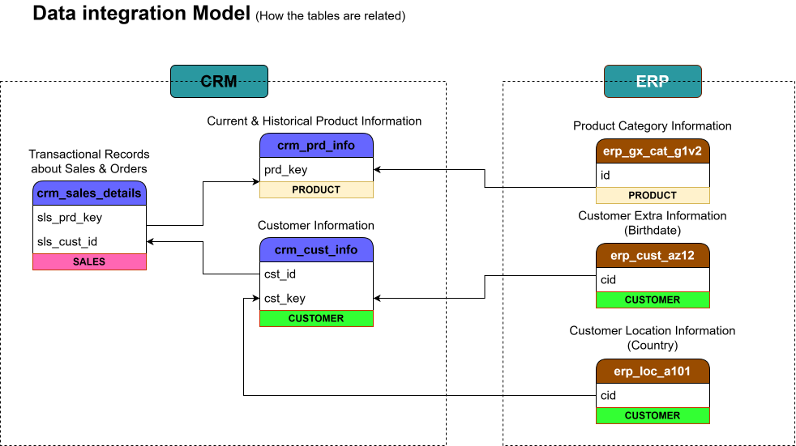
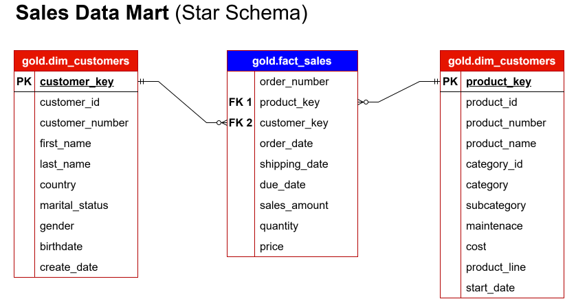

# Enterprise PostgreSQL Data Warehouse & Analytics Platform

This project delivers an end-to-end data pipeline built on **PostgreSQL**, utilizing a **Medallion Architecture** (Bronze, Silver, Gold) to process raw data into production-ready analytical models and reporting views.

---

## 📐 System Architecture & Visual Design

The project implements a structured Medallion pipeline, separating raw ingestion, clean transformation, and star-schema dimensional modeling. Visual documentation and design assets are stored in the [`docs/`](./docs) directory:

### 1. High-Level Data Architecture


### 2. End-to-End Pipeline Data Flow


### 3. Data Integration & Orchestration Model


### 4. Gold Layer Sales Mart (Star Schema)


---

## Module 1: Data Warehousing (Engineering)

### 1. Introduction
The core data warehousing engine manages raw data ingestion, transformation, and dimensional storage. Built entirely inside PostgreSQL using native `PL/pgSQL` procedural logic, it provides an isolated, reliable pipeline for scalable data processing.

### 2. Requirements
* **Database Engine:** PostgreSQL 14+
* **Administration Tools:** DBeaver or `psql` CLI
* **Execution Environment:** Local installation or Docker container

### 3. Objective
* Implement operational isolation across Bronze (Staging), Silver (Cleansed), and Gold (Dimensional) layers.
* Automate data cleansing, type casting, NULL handling, and deduplication using stored procedures while preserving logical anomalies for revenue integrity.
* Model raw transactional data into high-performance Star-Schema structures (Fact and Dimension tables).

### 4. Specification
* **Bronze Layer (`bronze` schema):** Raw data staging maintaining source structure and append-only metadata.
* **Silver Layer (`silver` schema):** Cleansed and standardized entities enforcing business validation rules and constraints via modular procedures.
* **Gold Layer (`gold` schema):** Dimensional models featuring surrogate primary keys, left-join referential integrity, and business-friendly aliasing.

---

## Module 2: Analytics & Reporting (Data Analytics)

### 1. Introduction
The analytics module exposes curated Gold-layer models to reporting tools and stakeholders. It focuses on pre-aggregated views and query performance to support fast, complex business decision-making.

### 2. Requirements
* **Access Level:** Read-only access to the `gold` schema
* **Visualization Tools:** Compatible with Power BI, Tableau, Metabase, or standard SQL reporting interfaces

### 3. Objective
* Deliver key performance indicators (KPIs) and business metrics with low-latency query execution.
* Reduce reporting load on base tables using optimized views and indexed foreign keys.
* Provide clean, self-serve data models for business analysts.

### 4. Specification
* **Analytical Views:** Pre-joined summary views aggregating revenue, customer metrics, and dimensional trends.
* **Query Optimization:** Optimized execution paths and surrogate key mappings.
* **Data Integrity:** Verification tests ensuring zero duplicate surrogate keys and accurate metric calculations.

---

## Repository Structure

```text
postgres-medallion-pipeline/
├── bronze/                     # Raw DDLs and ingestion staging scripts
├── silver/                     # Cleansed PL/pgSQL procedures & master orchestrator
│   └── master_orchestrator.sql
├── gold/                       # Star schema views & inline QA validation scripts
│   ├── dim_customers.sql
│   ├── dim_products.sql
│   └── fact_sales.sql
├── docs/                       # Architecture diagrams & Data Dictionary
│   ├── data_dictionary.md
│   ├── data_architecture.svg
│   ├── pipeline_data_flow.svg
│   ├── data_integration.svg
│   └── sales_mart.svg
└── README.md

Author & Brand
Asare Data Labs
Asare Data Labs is an independent data engineering practice specializing in modern database architecture, performance tuning, and robust ETL/ELT pipelines using PostgreSQL. Focused on delivering production-grade data infrastructure that scales cleanly for business intelligence and analytics.
•	GitHub: @asare-data-labs
•	Services: Data Warehousing, SQL Optimization, PL/pgSQL Pipeline Automation, Dimensional Modeling
License
This project is licensed under the MIT License - see the LICENSE file for details. You are free to use, modify, and distribute this codebase for personal or commercial projects.

